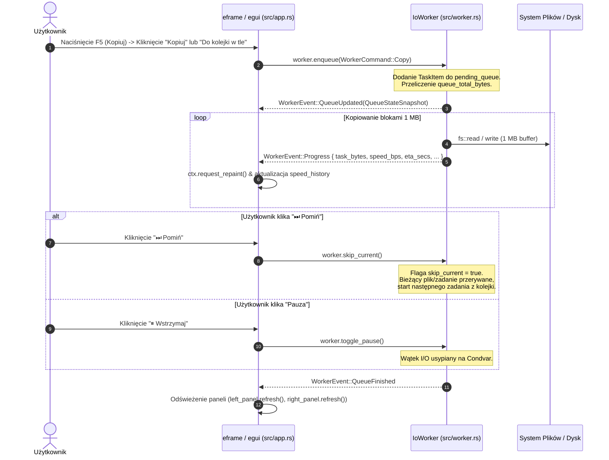

# AGENTS.md — Przewodnik dla Agentów AI po projekcie Huzar Commander

> **Cel dokumentu:** Ten plik stanowi oficjalne, techniczne kompendium architektury, konwencji, przepływów danych i zasad implementacyjnych dla autonomicznych agentów AI (Antigravity, Claude, Cursor, Copilot itp.) pracujących w tym repozytorium. Każdy agent przed przystąpieniem do modyfikacji kodu powinien zapoznać się z niniejszym przewodnikiem.

---

## 1. Przegląd i Koncepcja Projektu

**Huzar Commander** to klasyczny, dwupanelowy menedżer plików GUI (wzorowany na Norton Commander, Total Commander i FAR Manager), napisany w czystym języku **Rust** (edycja 2021) z wykorzystaniem biblioteki **eframe / egui 0.31** (tryb Immediate Mode GUI ze sprzętową akceleracją OpenGL/Glow). Nazwa nawiązuje do polskiej husarii — dwa rozpostarte skrzydła symbolizują dwa panele robocze, pancerz to gwarancja bezpieczeństwa pamięci, a prędkość szarży to wydajny streaming I/O.

### Główne założenia architektoniczne:
1. **Niezawodność i Zero-Crash (Rust Safety):** Pełne bezpieczeństwo pamięci, brak `unsafe` w kodzie domenowym, bezpieczna obsługa błędów I/O (`Result`, `Option`), brak panik.
2. **Płynność i Brak Blokowania UI (Zero-blocking Concurrency):** Wszelkie ciężkie operacje dyskowe (kopiowanie, usuwanie, przeszukiwanie rekurencyjne, rozpakowywanie ZIP) są bezwzględnie delegowane do dedykowanych wątków w tle (`IoWorker`, `SearchHandle`) i komunikują się z pętlą UI za pomocą nieblokujących kolejek kanałów `crossbeam-channel`.
3. **Pamięciooszczędność przy dużych plikach (Streaming I/O):**
   - Podgląd F3 nigdy nie ładuje całego pliku wielogigabajtowego do pamięci RAM — operuje na strumieniowaniu chunków 64 KB z bezpośrednim seekowaniem dyskowym.
   - Kopiowanie operuje na buforze 1 MB ze śledzeniem prędkości EMA, obliczaniem ETA i wielozadaniową kolejką transferów.
4. **Modułowość i Rozdzielenie Odpowiedzialności (Separation of Concerns):**
   - Stan interfejsu i okien jest ściśle oddzielony od stanu paneli i workerów (`src/ui/state.rs`).
   - Funkcje renderujące UI w `src/ui/` nie wykonują logiki biznesowej ani blokujących operacji I/O — zamiast tego emitują zdarzenia/akcje (`enum Action`).
   - Centralny orchestrator `CommanderApp` w [src/app.rs](file:///C:/Workspace/commander/src/app.rs) koordynuje przepływ zdarzeń, skrótów klawiaturowych i aktualizacji stanu.

---

## 2. Mapa Modułów i Struktura Katalogów

```
C:\Workspace\commander\
├── .cargo/
│   └── config.toml          # Domyślny target kompilacji: x86_64-pc-windows-gnullvm
├── assets/
│   ├── huzar_icon.png       # Główna ikona aplikacji (dwa skrzydła husarskie)
│   └── huzar_icon.ico       # Wielorozdzielcza ikona Windows (.ico) osadzana w pliku .exe
├── build.rs                 # Skrypt budowania (osadzanie ikony .ico w PE Windows przez windres)
├── locales/
│   ├── pl.json              # Standardowe tłumaczenia w języku polskim (PL)
│   └── en.json              # Standardowe tłumaczenia w języku angielskim (EN)
├── tests/                   # Zewnętrzne testy jednostkowe i integracyjne (15 modułów testowych)
│   ├── config_tests.rs
│   ├── drives_tests.rs
│   ├── fs_item_tests.rs
│   ├── i18n_tests.rs
│   ├── opener_tests.rs
│   ├── panel_tests.rs
│   ├── search_tests.rs
│   ├── ui_file_dialogs_tests.rs
│   ├── ui_markdown_tests.rs
│   ├── ui_mermaid_tests.rs
│   ├── ui_panels_tests.rs
│   ├── ui_state_tests.rs
│   ├── ui_structured_tests.rs
│   ├── worker_tests.rs
│   └── zip_tests.rs
├── src/
│   ├── lib.rs               # Eksport modułów bibliotecznych (huzar_commander)
│   ├── main.rs              # Punkt wejściowy, ikona okna, eframe::run_native
│   ├── app.rs               # Centralny orchestrator (CommanderApp, App::update, skróty)
│   ├── config.rs            # Konfiguracja edytorów i skojarzeń (AppConfig, load/save JSON)
│   ├── drives.rs            # Wykrywanie napędów, Win32 API, wolne/całkowite miejsce
│   ├── fs_item.rs           # Model pliku (FileItem), kryteria sortowania (SortColumn, SortOrder)
│   ├── i18n.rs              # Moduł internacjonalizacji i18n: Language (Pl/En), embedded fallback + override z dysku
│   ├── opener.rs            # Uruchamianie programów skojarzonych, podgląd F3, chunking 64 KB
│   ├── panel.rs             # Stan panelu (PanelState), nawigacja, filtrowanie, wirtualny ZIP
│   ├── search.rs            # Asynchroniczny silnik wyszukiwania (SearchHandle, SearchParams)
│   ├── worker.rs            # Silnik kolejki I/O (IoWorker, WorkerCommand, TaskItem, telemetria)
│   ├── zip_support.rs       # Odczyt, wirtualne drzewo i ekstrakcja archiwów ZIP
│   └── ui/                  # Warstwa prezentacji Immediate Mode (egui)
│       ├── mod.rs           # Eksport podmodułów UI
│       ├── state.rs         # Enkapsulowane stany modalne (FileOps, Search, Viewer, Progress)
│       ├── panels.rs        # Rendering kolumn paneli, tabela z wirtualnym scrollem
│       ├── viewer_window.rs # Okno F3: strumieniowanie, Text/Hex/Markdown, suwak, paginacja, ograniczenie rozmiaru do okna
│       ├── markdown_viewer.rs # Natywny, czysty silnik renderowania Markdown (bloki kodu, tabele, listy, diagramy Mermaid)
│       ├── structured_viewer.rs # Podgląd JSON i YAML: kolorowanie składni, numeracja linii, interaktywne drzewo obiektów
│       ├── mermaid_layout.rs # Czysty silnik parsowania i układu diagramów Mermaid (Sugiyama layout)
│       ├── mermaid_painter.rs # Natywny renderer diagramów graficznych Mermaid w egui (flowchart, sequence, pie itp.)
│       ├── dialog_search.rs # Okno Alt+F7: maska, zawartość tekstu, tabela wyników
│       ├── dialog_queue.rs  # Okno kolejki, modal postępu, wykres prędkości, pasek tła
│       ├── file_dialogs.rs  # Dialogi: Mkdir (F7), Delete (F8), Copy (F5), Move (F6), Dyski, O programie (z logo husarii)
│       └── menu_bars.rs     # Górne menu z brandingiem, pasek F1-F10, wiersz poleceń CLI ze statusem
├── Cargo.toml               # Zależności i metadane crate (huzar-commander)
├── run.ps1                  # Skrypt uruchomieniowy PowerShell dla środowiska Windows
└── AGENTS.md                # Niniejszy przewodnik dla Agentów AI
```

### Szczegółowa odpowiedzialność modułów:

| Moduł / Plik | Odpowiedzialność |
|---|---|
| [src/main.rs](file:///C:/Workspace/commander/src/main.rs) | Bootstrap aplikacji. Inicjalizacja `NativeOptions` z akceleracją Glow, maksymalizacja okna, start pętli `eframe::run_native`. |
| [src/app.rs](file:///C:/Workspace/commander/src/app.rs) | Główny koordynator. Implementuje `eframe::App`. Odpytuje komunikaty z workerów i wątków wyszukiwania, obsługuje globalne skróty klawiszowe, zdejmuje focus z menu podczas nawigacji i deleguje rendering do `ui/`. |
| [src/ui/state.rs](file:///C:/Workspace/commander/src/ui/state.rs) | Czyste struktury stanu GUI: `FileOpsState`, `DriveMenuState`, `ProgressUiState`, `SearchDialogState`, `ViewerWindowState`. Zawiera metody nawigacji chunków F3 (`seek_next`, `seek_prev`, `reload_chunk`). |
| [src/ui/panels.rs](file:///C:/Workspace/commander/src/ui/panels.rs) | Układ dwukolumnowy (`render_dual_panels`), renderowanie pojedynczego panelu (`render_panel`), wirtualna tabela `TableBuilder`, podświetlenie wierszy, obsługa PPM i kliknięć. |
| [src/ui/viewer_window.rs](file:///C:/Workspace/commander/src/ui/viewer_window.rs) | Kompletny komponent okna F3: nagłówek z przyciskiem `[X]`, Text/Hex/Markdown, wskaźnik pozycji i procentu, suwak pliku, paginacja 64 KB, ograniczenie rozmiaru do okna aplikacji (`constrain`, clamp), obsługa klawiszy `PgUp`/`PgDn`/`Home`/`End`/`Esc`. |
| [src/ui/markdown_viewer.rs](file:///C:/Workspace/commander/src/ui/markdown_viewer.rs) | Zaawansowany silnik renderowania CommonMark/Markdown: nagłówki z separatorami, bloki kodu z etykietą i przyciskiem kopiowania, listy zagnieżdżone, cytaty, tabele oraz graficzne diagramy Mermaid. |
| [src/ui/structured_viewer.rs](file:///C:/Workspace/commander/src/ui/structured_viewer.rs) | Silnik podglądu JSON i YAML: tokenizowane kolorowanie składni z numeracją linii, walidacja błędów, przełącznik widoku oraz interaktywne drzewo obiektów z odznakami typów i kopiowaniem wartości. |
| [src/ui/mermaid_layout.rs](file:///C:/Workspace/commander/src/ui/mermaid_layout.rs) | Czysty, bezpołączeniowy silnik parsowania i wyliczania geometrii diagramów Mermaid (Sugiyama layout, Flowchart, Sequence, Pie, Gantt, Git, Journey). |
| [src/ui/mermaid_painter.rs](file:///C:/Workspace/commander/src/ui/mermaid_painter.rs) | Natywny renderer diagramów egui (rysowanie wektorowe przez Painter, skalowanie do szerokości, scroll poziomy). |
| [src/ui/dialog_queue.rs](file:///C:/Workspace/commander/src/ui/dialog_queue.rs) | Okno zarządzania kolejką zadań, modal transferu z wykresem fali cyan (`render_speed_graph`), wskaźnikami ETA/prędkości oraz dolny pasek zadań w tle. |
| [src/ui/file_dialogs.rs](file:///C:/Workspace/commander/src/ui/file_dialogs.rs) | Okna modalne operacji na plikach (F5, F6, F7, F8), wybór dysków (Alt+F1/Alt+F2 z obsługą klawiszy literowych) oraz okno „O programie” (F1). |
| [src/ui/dialog_search.rs](file:///C:/Workspace/commander/src/ui/dialog_search.rs) | Modal wyszukiwania (Alt+F7): maska, tekst, przeszukiwanie rekurencyjne, wielkość liter, tabela wyników i przyciski akcji (`Przejdź do pliku`, `Podgląd F3`). |
| [src/ui/menu_bars.rs](file:///C:/Workspace/commander/src/ui/menu_bars.rs) | Górny pasek menu rozwijanego, dolny pasek klawiszy F1–F10 (z `surrender_focus()`), linia poleceń CLI oraz 5-sekundowy pasek komunikatów statusu. |
| [src/panel.rs](file:///C:/Workspace/commander/src/panel.rs) | Reprezentacja stanu panelu (`PanelState`). Skanowanie katalogów, filtracja na żywo (`filter`, `apply_filter`), sortowanie stabilne z zachowaniem kursora, wirtualny tryb archiwum ZIP (`zip_location`). |
| [src/worker.rs](file:///C:/Workspace/commander/src/worker.rs) | Silnik wielozadaniowej kolejki transferu (`IoWorker`). Wątek I/O z buforem 1 MB, obsługa `Copy`, `Move`, `Delete`, `CreateDir`, `ExtractZip`, pauza/wznowienie przez `Condvar`, natychmiastowe pomijanie zadań (`skip_current`) oraz agregacja ETA. |
| [src/search.rs](file:///C:/Workspace/commander/src/search.rs) | Dedykowany wątek wyszukiwarki plików. Dopasowywanie masek wieloznacznych (obsługuje średniki np. `*.rs;*.toml`), przeszukiwanie strumieniowe treści plików, token anulowania `AtomicBool`. |
| [src/opener.rs](file:///C:/Workspace/commander/src/opener.rs) | Uruchamianie programów skojarzonych dla plików (video, audio, exe itp.), wykrywanie plików multimedialnych/graficznych, niskopoziomowy odczyt chunków `read_file_chunk` i formatowanie Hex dumpera. |
| [src/zip_support.rs](file:///C:/Workspace/commander/src/zip_support.rs) | Parsowanie archiwów ZIP, generowanie wirtualnej struktury folderów dla nawigacji oraz selektywna/całościowa dekompresja. |
| [src/drives.rs](file:///C:/Workspace/commander/src/drives.rs) | Wykrywanie dysków systemowych Windows za pomocą Win32 API (`GetLogicalDrives`, `GetVolumeInformationW`, `GetDiskFreeSpaceExW`) oraz uniksowy fallback. |
| [src/config.rs](file:///C:/Workspace/commander/src/config.rs) | Zarządzanie konfiguracją aplikacji (`AppConfig`): domyślny edytor, mapa rozszerzeń do programów, trwały zapis i odczyt z pliku `config.json`. |
| [src/ui/dialog_config.rs](file:///C:/Workspace/commander/src/ui/dialog_config.rs) | Okno dialogowe konfiguracji edytorów i skojarzeń (dostępne z menu Opcje -> Skojarzenia edytorów). |
| [src/i18n.rs](file:///C:/Workspace/commander/src/i18n.rs) | Silnik internacjonalizacji (i18n): obsługa wielu języków (PL, EN), płaskie i zagnieżdżone klucze JSON, pre-kompilowany fallback `include_str!` oraz możliwość nadpisywania z katalogu `locales/` na dysku w czasie rzeczywistym. |
| [src/fs_item.rs](file:///C:/Workspace/commander/src/fs_item.rs) | Struktura metadanych wpisu w plikach (`FileItem`), kolorowanie wg rozszerzeń, wskaźniki katalogów i formatowanie daty. |

---

## 3. Kluczowe Przepływy Danych i Wzorce (Architectural Patterns)

### 3.1. Przepływ Asynchronicznych Operacji I/O (Worker Queue)



### 3.2. Strumieniowy Podgląd Dużych Plików (F3 Stream Viewer)

1. Gdy użytkownik naciska `F3` na pliku multimedialnym lub graficznym (rozszerzenia: `.png`, `.jpg`, `.mp4`, `.mkv` itp.), `CommanderApp::trigger_f3_view()` deleguje otwarcie do systemowego programu domyślnego (`open::that`).
2. Dla pozostałych plików (tekst, kod, binarne, archiwa) wywoływana jest metoda `ViewerWindowState::open_file()`.
3. Plik nie jest wczytywany w całości do pamięci RAM:
   - Funkcja `read_file_chunk(path, offset, 64 * 1024)` odczytuje dokładnie 64 KB z dysku.
   - Detekcja binarności (`detect_is_binary`) oraz rozszerzenia Markdown (`is_markdown_file`) decyduje o domyślnym trybie (`ViewerMode::Hex`, `ViewerMode::Text` lub `ViewerMode::Markdown`).
   - W trybie `ViewerMode::Markdown` zawartość renderowana jest sformatowana przez bibliotekę `egui_commonmark` (nagłówki, tabele, kod, listy itp.) z możliwością natychmiastowego przełączenia na surowy tekst lub hex.
   - W oknie podglądu użytkownik może przesuwać suwak (seek proporcjonalny w zakresie `0..total_size`) lub używać przycisków paginacji (`seek_next`, `seek_prev`), co powoduje przeładowanie tylko aktywnego chunka 64 KB.

### 3.3. Zarządzanie Focusem i Nawigacją Klawiatury (Focus Surrender Pattern)

W bibliotece `egui` przyciski menu (`egui::menu::bar`) lub aktywne kontrolki tekstowe potrafią przechwycić klawisz `Enter`, co w klasycznym menedżerze plików powodowałoby niepożądane ponowne otwarcie menu zamiast wejścia do folderu pod kursorem.
W projekcie zastosowano ścisłą dyscyplinę:
1. Po kliknięciu dowolnego przycisku w menu górnym lub pasku F1–F10 wołana jest metoda `resp.surrender_focus()`.
2. Przy jakiejkolwiek nawigacji w panelach (strzałki, Tab, kliknięcie myszą, Home, End, PgUp, PgDn) wywoływane jest:
   ```rust
   ctx.memory_mut(|mem| {
       mem.stop_text_input();
       mem.close_popup();
   });
   ```
3. Przy naciśnięciu klawisza `Enter` na wierszu pliku następuje jawna konsumpcja klawisza:
   ```rust
   ctx.input_mut(|i| i.consume_key(egui::Modifiers::NONE, egui::Key::Enter));
   ```
   dzięki czemu `Enter` nie propaguje się do kontrolek egui.

---

## 4. Zasady Implementacyjne dla Agentów AI

Przy wprowadzaniu modyfikacji w kodzie Agenci AI muszą bezwzględnie przestrzegać poniższych reguł:

### Reguła 1: Zero blokowania wątku UI
Nigdy nie wywołuj synchronicznych pętli I/O, `std::thread::sleep`, `walkdir::WalkDir` ani długich operacji dyskowych wewnątrz `App::update()` ani w funkcjach w `src/ui/`.
- Jeśli zadanie wymaga I/O -> dodaj komendę do `WorkerCommand` w [src/worker.rs](file:///C:/Workspace/commander/src/worker.rs).
- Jeśli zadanie wymaga przeszukiwania -> skorzystaj z wątku w [src/search.rs](file:///C:/Workspace/commander/src/search.rs).

### Reguła 2: Odseparowanie logiki UI (Wzorzec Action/Event)
Pliki w katalogu `src/ui/` odpowiadają wyłącznie za prezentację (układ okien, widgety, kolory).
- Funkcje UI nie powinny mutować `CommanderApp` bezpośrednio, lecz zwracać odpowiedni `Option<ActionEnum>` (np. `PanelAction`, `SearchDialogAction`, `FileOpsAction`, `MenuAction`).
- `CommanderApp` w [src/app.rs](file:///C:/Workspace/commander/src/app.rs) odbiera akcję i wykonuje odpowiednią mutację stanu.

### Reguła 3: Rust Borrow Checker w Immediate Mode
Ponieważ `CommanderApp` zawiera wiele pól, wywołanie metody z `&mut self` uniemożliwia jednoczesne pożyczenie innych pól `self`.
- Dlatego pola zostały zgrupowane w sub-stany: `file_ops`, `progress`, `search`, `viewer`, `drive_menu`.
- Przekazuj do funkcji pomocniczych tylko referencje do potrzebnych sub-stanów (np. `render_progress_dialog(ctx, &mut self.progress, &self.worker, &self.queue_snapshot)`), co pozwala borrow checkerowi precyzyjnie śledzić niezależne pożyczenia pól.

### Reguła 4: Żądanie odświeżania (`ctx.request_repaint()`)
`egui` jest silnikiem Immediate Mode, który odrysowuje klatki na żądanie (oszczędzając CPU/GPU). Jeśli w tle działa transfer dyskowy (`self.progress.is_open`) lub przeszukiwanie plików (`self.search.handle.is_some()`), w każdej klatce `update()` musi zostać wywołane:
```rust
if self.progress.is_open || self.search.handle.is_some() {
    ctx.request_repaint();
}
```
Zapewnia to 60 FPS dla neonowego wykresu prędkości oraz płynną aktualizację liczników bajtów i ETA.

### Reguła 5: Zachowanie testów jednostkowych i integracyjnych
Projekt posiada 85 testów jednostkowych i integracyjnych w katalogu `tests/` (15 plików testowych).
Przed zakończeniem zadania agent **musi** uruchomić `cargo test` i upewnić się, że wszystkie testy przechodzą pomyślnie.

---

## 5. Środowisko Budowania i Narzędzia (Windows Toolchain)

Projekt skonfigurowany jest pod system **Windows** z wykorzystaniem toolchaina LLVM/GNU:
- Plik [.cargo/config.toml](file:///C:/Workspace/commander/.cargo/config.toml) ustawia domyślny target na:
  ```toml
  [build]
  default = "x86_64-pc-windows-gnullvm"
  ```
- Wynikowy plik binarny kompiluje się do ścieżki:
  - Debug: `target\x86_64-pc-windows-gnullvm\debug\huzar-commander.exe` (kopia: `target\debug\huzar-commander.exe`)
  - Release: `target\x86_64-pc-windows-gnullvm\release\huzar-commander.exe` (kopia: `target\release\huzar-commander.exe`)

### Typowe polecenia kompilacji:
1. **Odmowa dostępu / Plik zablokowany (`os error 5`):**
   Jeśli proces aplikacji był uruchomiony, Windows blokuje plik `.exe` przed nadpisaniem. Zawsze przed kompilacją zatrzymaj stary proces:
   ```powershell
   Stop-Process -Name huzar-commander -ErrorAction SilentlyContinue -Force
   ```
2. **Kompilacja i sprawdzanie:**
   - Szybka walidacja typów: `cargo check`
   - Uruchomienie testów: `cargo test`
   - Budowanie debug: `cargo build` (lub `.\run.ps1`)
   - Budowanie release: `cargo build --release` (lub `.\build_release.ps1`)
   - Uruchomienie release: `cargo run --release` (lub `.\run_release.ps1`)
3. **Brak okna konsoli w tle (Windows GUI Subsystem):**
   W [src/main.rs](file:///C:/Workspace/commander/src/main.rs) zdefiniowano atrybut `#![windows_subsystem = "windows"]`, dzięki czemu plik PE ma ustawiony podsystem GUI (`IMAGE_SUBSYSTEM_WINDOWS_GUI = 2`). Zapobiega to automatycznemu otwieraniu czarnego okna konsoli/terminala przez system Windows przy uruchamianiu programu.

### Wsparcie dla systemu Linux (Cross-platform):
Projekt jest w pełni kompatybilny z Linuksem (X11 oraz Wayland):
- W [Cargo.toml](file:///C:/Workspace/commander/Cargo.toml) skonfigurowano sekcję `[target.'cfg(target_os = "linux")'.dependencies]` z włączonymi flagami `["x11", "wayland"]` dla biblioteki `eframe`.
- Kod wspiera automatycznie zarówno Windows (`Win32 API`, `ShellExecuteW`, `cmd.exe`), jak i Unix/Linux (`libc`, `statvfs`, `/proc/mounts`, `sh`, `xdg-open`).
- Weryfikacja kompilacji na Linux: `cargo check --target x86_64-unknown-linux-gnu`.

---

## 6. Przewodnik krok-po-kroku: Jak rozszerzać projekt

### Przypadek A: Dodanie nowego skrótu klawiszowego
1. Otwórz [src/app.rs](file:///C:/Workspace/commander/src/app.rs) i przejdź do metody `CommanderApp::handle_keyboard_shortcuts()`.
2. Dodaj warunek w bloku `ctx.input(|i| { ... })`.
3. Jeśli skrót nawiguje po panelach, ustaw flagę `is_panel_nav = true` (zdejmie to focus z menu i zamknie ewentualne otwarte popupy).
4. Jeśli skrót dotyczy dialogu, upewnij się, że warunek `has_modal` poprawnie blokuje lub przepuszcza skrót.

### Przypadek B: Dodanie nowego okna dialogowego
1. Zdefiniuj strukturę stanu okna w [src/ui/state.rs](file:///C:/Workspace/commander/src/ui/state.rs) (oraz `Default`).
2. Dodaj pole stanu do `CommanderApp` w [src/app.rs](file:///C:/Workspace/commander/src/app.rs).
3. Stwórz funkcję renderującą w `src/ui/` (lub w [src/ui/file_dialogs.rs](file:///C:/Workspace/commander/src/ui/file_dialogs.rs)), zwracającą `Option<TwojaAkcja>`.
4. Wywołaj funkcję w `CommanderApp::render_dialogs()` i obsłuż wynikową akcję.
5. Dodaj flagę `self.twoj_dialog.is_open` do warunku `has_modal` w `handle_keyboard_shortcuts()`.

### Przypadek C: Dodanie nowej komendy do wątku w tle
1. Dodaj wariant do enum `WorkerCommand` w [src/worker.rs](file:///C:/Workspace/commander/src/worker.rs).
2. Dodaj obsługę wariantu w pętli roboczej `run_worker_thread()` w [src/worker.rs](file:///C:/Workspace/commander/src/worker.rs).
3. Dodaj test jednostkowy weryfikujący nową komendę w `worker::tests`.
4. Wywołaj zlecenie przez `self.worker.enqueue(WorkerCommand::TwojaKomenda)` w [src/app.rs](file:///C:/Workspace/commander/src/app.rs).

---

## 7. Status Projektu i Metryki Jakości

- **Stan kompilacji:** 0 błędów, 0 ostrzeżeń (`cargo check` / `cargo build` clean, 0 ostrzeżeń clippy).
- **Stan testów:** 86/86 testów jednostkowych i integracyjnych w katalogu `tests/` przechodzi pomyślnie (15 plików testowych).
- **Branding & Ikona:** Ikona skrzydeł husarskich (`assets/huzar_icon.png`, `assets/huzar_icon.ico`) zintegrowana w nagłówku PE Windows (`build.rs`), oknie `eframe::NativeOptions`, oknie F1 „O programie” oraz prawym rogu górnego menu.
- **Wydajność I/O:** Prędkość kopiowania na poziomie dysku SSD (bufor 1 MB), responsywność interfejsu GUI stabilne 60 FPS, brak alokacji RAM przy podglądzie dużych plików wielogigabajtowych.
