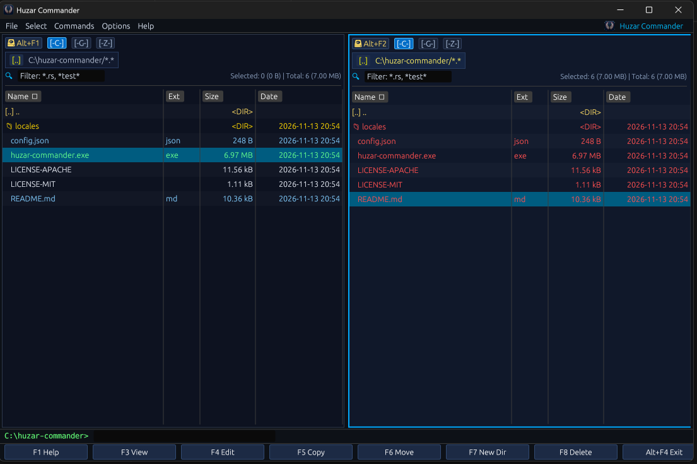

# Huzar Commander

> **Language / Język:** [English](README.md) | [Polski](README_PL.md)

[](#license)
[](https://www.rust-lang.org/)
[](https://github.com/emilk/egui)
[](#unit-and-integration-tests)

A modern, dual-pane orthodox GUI file manager written in pure Rust, inspired by Norton Commander, Total Commander, and FAR Manager. The name draws inspiration from the Polish Hussars (*husaria*) — the two outspread wings represent the two work panels, the armor symbolizes Rust's memory safety guarantees, and the cavalry charge speed reflects blazingly fast I/O streaming with real-time telemetry.



## Features

- **Dual-Pane Layout (Orthodox):** Left and right panels with independent navigation, active window accent highlighting, and pixel-perfect clipping (panels never overlap).
- **Asynchronous, Cancellable Directory Loading (`Esc`):** Non-blocking background directory scanner for network drives (SMB/UNC shares like `\\server\share`) and slow storage. If connecting or listing files takes time, the interface never freezes: an animated loading indicator with live timer and a `[ ✖ Cancel (Esc) ]` button is displayed, allowing instant cancellation and return to the previous directory at any time, while the other panel remains 100% interactive.
- **Drive Selection (`Alt+F1` / `Alt+F2`):** 
  - `Alt+F1` opens the drive selection dialog for the left panel.
  - `Alt+F2` opens the drive selection dialog for the right panel.
  - Quick selection by pressing the drive letter directly (e.g., pressing `C` or `D` instantly changes the drive).
  - Arrow key navigation (`Up` / `Down` + `Enter`) or mouse click.
  - Displays volume labels (e.g., `Windows`, `Data`), free and total storage, and a visual usage bar.
  - Quick-access buttons `🖴 Alt+F1` and `🖴 Alt+F2` located directly on each panel's drive bar.
- **Drive Bar:** Fast drive switching (`[-C-]`, `[-D-]`, etc.) with active drive indicator.
- **File Table (Virtual Scrolling):** Smooth scrolling with automatic active cursor tracking (`scroll_to_row`). Columns: Name (flexible), Extension, Size (right-aligned), Date Modified (right-aligned).
- **Color-Coded File Types:**
  - 📁 Directories and `[..]` in gold/yellow
  - 🟢 Executables (`.exe`, `.bat`, `.cmd`) in light green
  - 🟠 Archives (`.zip`, `.rar`, `.7z`) in orange
  - 🔵 Code and text (`.rs`, `.toml`, `.txt`) in cyan
  - 🔴 Selected items in vivid red (classic Total Commander style)
- **Sorting:** Clicking any column header (Name, Extension, Size, Date) sorts the list while maintaining the cursor on the currently selected item.
- **Selection:** 
  - `Insert` key toggles selection and moves the cursor down one row.
  - `Space` key toggles selection and moves down; for folders, starts asynchronous background size calculation (displaying `<...>` while calculating) without freezing the UI.
  - Right Mouse Button (RMB) toggles selection on the item under the cursor.
  - Clicking anywhere on a row moves the cursor and activates the panel.
  - *Select* menu: Select all, Deselect all, Invert selection, Select/Deselect by mask (`+` / `-`).
  - Panel header status summary displays the count and total size of selected items.
- **Copying with Real-Time Telemetry (`F5`):**
  - **SSD Native Speed:** 1 MB buffered block copying without redundant overhead.
  - **Real-Time Speed Graph:** Neon cyan live line graph with dynamic peak auto-scaling.
  - **Dual Progress Bars:** Current file progress and overall task progress.
  - **Estimated Time of Arrival (ETA):** Accurate `HH:MM:SS` countdown computed from an Exponential Moving Average (EMA) and remaining bytes.
  - **Elapsed Time:** High-precision operation stopwatch.
  - **Background Transfer (`Background`):** Minimize the transfer dialog into a compact bottom status bar and continue using the entire application seamlessly during file transfers!
  - **Show Details:** Instant one-click restoration from the bottom bar back into the full telemetry modal.
  - **Cancel:** Immediate, safe cancellation of the active operation at any time.
- **Background Transfer Queue Manager:**
  - Multitasking: new copy/move operations enqueued during an ongoing transfer are dynamically queued without blocking or waiting for previous tasks to finish.
  - Aggregated Metrics: real-time recalculation of total queue size and combined overall ETA.
  - Queue Controls: Pause (`⏸ Pause`), Resume (`▶ Resume`), Skip current task (`⏭ Skip`) in the transfer dialog, bottom status bar, or dedicated Queue Window, as well as Cancel Entire Queue.
  - Dedicated queue management window with task list and live telemetry.
- **File Search (`Alt+F7`):**
  - Asynchronous, multi-threaded search without freezing the user interface.
  - File masks and wildcard patterns (e.g., `*.rs`, `*test*`, `*.txt;*.md`).
  - Text content search within files (with case-sensitive and case-insensitive options).
  - Clean results table with match preview, path, and size.
  - "Go to file" (instantly navigates the panel to the folder and selects the file) and "View (F3)" buttons.
- **ZIP Archive Support:**
  - Browse ZIP archives seamlessly just like regular folders (enter with `Enter` or double click).
  - Virtual navigation through nested subdirectories and return to parent (`[..]` / `Backspace`).
  - Quick file preview inside archives using `F3`.
  - Extract selected files or the entire archive (`F5`) to the opposite panel.
- **Live File Filtering:**
  - Built-in `🔍` filter input directly in each panel header (shortcut `Ctrl+F`).
  - Real-time filtering by mask (`*.rs`), multiple extensions (`*.rs;*.toml`), or substring match.
  - Clear filter with a single click `✖` or `Esc` key.
- **Move / Rename (`F6`):** Blazing fast atomic move on the same volume, or buffered copy-with-delete across different filesystems.
- **Create Folder (`F7`):** Dialog with new directory name input.
- **Delete (`F8` / `Delete`):** With option for safe deletion to the system Recycle Bin.
- **Quick View (`F3`):** Modal streaming viewer (64 KB chunks) supporting Text, Hex dumper, Markdown (with Mermaid diagram rendering), and JSON/YAML with syntax highlighting and interactive tree view.
- **Edit (`F4`):** Open in default text editor (Notepad) or configured custom editor associations.
- **Integrated Command Line (CLI):** Execute arbitrary OS shell commands directly in the working directory of the active panel.

## Keyboard Shortcuts

| Shortcut | Action |
|---|---|
| `Tab` | Switch active panel (Left <-> Right) |
| `Enter` | Enter directory / Open associated file / Enter ZIP archive |
| `Backspace` | Navigate to parent directory (`..`) |
| `Up / Down Arrows` | Move cursor with automatic scroll tracking |
| `PageUp / PageDown` | Jump 15 rows up / down |
| `Home / End` | Jump to beginning / end of file list |
| `Insert` | Select item and move cursor 1 row down |
| `Space` | Select item / Calculate folder size in background and move down |
| `Right Mouse Button` | Select / deselect item under cursor |
| `Row Click` | Set cursor on item and activate panel |
| `Double Click (LMB)` | Enter directory / Open file |
| `F1` | Help / About (version, technologies, shortcuts, and licenses) |
| `F3` | Quick view file (Text / Hex / Markdown / JSON / YAML) |
| `F4` | Edit file in configured editor |
| `F5` | Copy (with speed graph, ETA, and background queue option) |
| `F6` | Move / Rename |
| `F7` | Create new directory |
| `F8` or `Delete` | Delete files / directories (optional Recycle Bin) |
| `Alt+F1` | Select drive for left panel (drive dialog) |
| `Alt+F2` | Select drive for right panel (drive dialog) |
| `Alt+F7` | Search files (by name and content) |
| `Ctrl+F` | Quick filter files in active panel |
| `Esc` | Clear filter / Close active modal dialog |
| `Alt+F4` | Exit application |

## Running and Building

### Windows
In a PowerShell terminal in the project directory:

* **Development build (Debug):**
  ```powershell
  .\run.ps1
  # or:
  cargo run
  ```

* **Production build (Release):**
  ```powershell
  .\build_release.ps1
  # or directly via Cargo:
  cargo build --release
  ```
  The compiled `.exe` executable will be placed in:
  `target\release\huzar-commander.exe`

* **Run Release version:**
  ```powershell
  .\run_release.ps1
  # or:
  cargo run --release
  ```

* **Generate Universal Windows Installer (.exe):**
  ```powershell
  .\build_installer.ps1
  ```
  Produces `target\installer\HuzarCommander-Setup-v0.2.0.exe` (Inno Setup) with bilingual support (PL/EN), desktop & start menu shortcuts, uninstaller in Windows Settings, and Windows Explorer context menu integration (*"Open in Huzar Commander"*).

### Linux / Ubuntu / Debian
Before running for the first time, ensure the standard windowing and rendering development packages (X11 / Wayland / OpenGL) are installed:
```bash
sudo apt update
sudo apt install -y build-essential pkg-config libxkbcommon-dev libgl1-mesa-dev libfontconfig1-dev
```
Run:
```bash
chmod +x ./run.sh
./run.sh
# or directly:
cargo run
```

On Linux, the file manager automatically detects:
- Root filesystem `/` (shortcut `[-R-]` / key `R` or `/`),
- User home directory `$HOME` (shortcut `[-H-]` / key `H`),
- All physical and network mount points from `/proc/mounts`, `/mnt`, and `/media` (with drive letter shortcuts `[-A-]`, `[-B-]`, etc.).
- Capacities and free disk space are queried via standard POSIX `statvfs`.

## Unit and Integration Tests

The project features a comprehensive suite of **86 automated tests** (across 15 test modules in the `tests/` directory) covering:
- File metadata parsing and attributes (`fs_item`),
- Dual-panel sorting, selection, and asynchronous cancellable directory loading (`panel`),
- Selection operations (`toggle_select`, `select_all`, `deselect_all`, `invert_selection`) and aggregated size calculation (`panel`),
- System drive detection and volume capacity queries (`drives`),
- Asynchronous I/O engine: directory creation, file copying and moving, task queue handling (`worker`),
- ZIP archives: virtual tree browsing, compression, and decompression (`zip_support`),
- Internationalization (i18n): PL/EN key parity, language detection, and formatting (`i18n`),
- Viewer engines: Markdown, JSON/YAML, Mermaid diagrams, Hex dumper, and 64 KB streaming buffer (`viewer`).

Running tests:
```powershell
cargo test
```

## License

This project is licensed under a dual license, standard in the Rust ecosystem:

* **MIT License** ([LICENSE-MIT](LICENSE-MIT))
* **Apache License, Version 2.0** ([LICENSE-APACHE](LICENSE-APACHE))

You may choose either license at your discretion.
