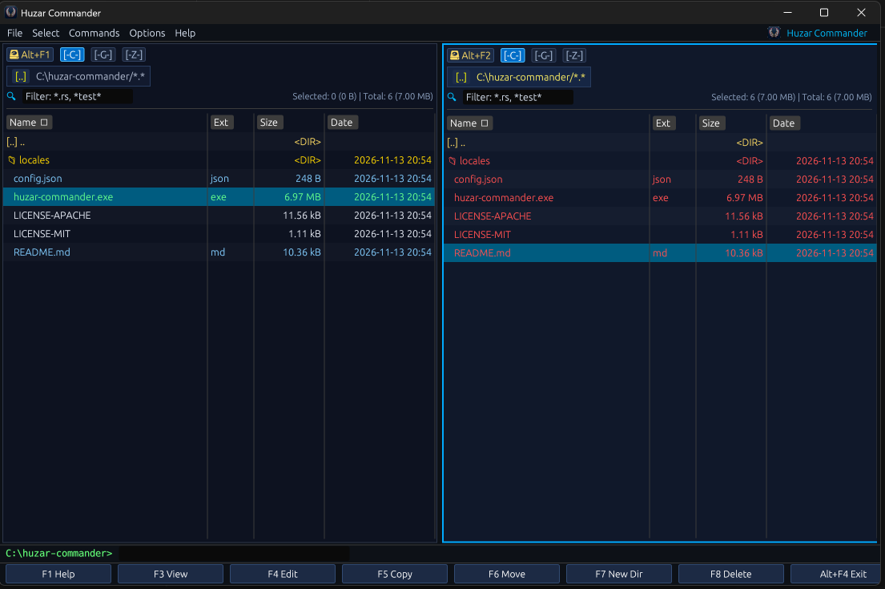

# Huzar Commander

> **Język / Language:** [Polski](README_PL.md) | [English](README.md)

[](#licencja)
[](https://www.rust-lang.org/)
[](https://github.com/emilk/egui)
[](#testy-jednostkowe-i-integracyjne)

Nowoczesny, dwupanelowy menedżer plików GUI w języku Rust wzorowany na Norton Commander, Total Commander i FAR Manager. Nazwa nawiązuje do polskiej husarii – dwa rozpostarte skrzydła symbolizują dwa panele, pancerz to gwarancja bezpieczeństwa pamięci Rusta, a szybkość szarży to błyskawiczne operacje I/O z telemetrią w czasie rzeczywistym.



## Funkcjonalności

- **Układ dwupanelowy (Dual-pane):** Lewy i prawy panel z niezależną nawigacją, podświetleniem aktywnego okna i precyzyjnym obcinaniem krawędzi (panele nigdy na siebie nie nachodzą).
- **Asynchroniczne wczytywanie katalogów z możliwością przerwania (Esc):** Płynne, nieblokujące skanowanie folderów i dysków sieciowych (SMB/UNC np. `\\serwer\udzial`) w tle. Jeśli łączenie lub odczyt zasobu trwa długo, interfejs nigdy nie zamarza – wyświetlany jest estetyczny ekran ładowania z animowanym spinnerem, stoperem oraz przyciskiem `[ ✖ Anuluj (Esc) ]`, który natychmiast przerywa oczekiwanie i przywraca poprzedni katalog, a drugi panel pozostaje cały czas w pełni responsywny.
- **Wybór dysków (Alt+F1 / Alt+F2):** 
  - Klawisz `Alt+F1` otwiera okno wyboru dysku dla lewego panelu.
  - Klawisz `Alt+F2` otwiera okno wyboru dysku dla prawego panelu.
  - Bezpośredni wybór po naciśnięciu litery dysku (np. klawisz `C` lub `D` natychmiast zmienia dysk).
  - Nawigacja strzałkami `Góra`/`Dół` + `Enter` lub kliknięcie myszą.
  - Wyświetlanie etykiety woluminu (np. `Windows`, `Dane`), wolnego i całkowitego miejsca oraz wskaźnika zajętości.
  - Przyciski `🖴 Alt+F1` oraz `🖴 Alt+F2` bezpośrednio na pasku dysków każdego panelu.
- **Pasek dysków:** Szybkie przełączanie dysków (`[-C-]`, `[-D-]`, itp.) z podświetleniem aktywnego dysku.
- **Tabela plików (Virtual Scrolling):** Płynne przewijanie z automatycznym śledzeniem pozycji kursora (`scroll_to_row`). Kolumny: Nazwa (elastyczna), Rozszerzenie, Rozmiar (do prawej), Data modyfikacji (do prawej).
- **Wielobarwne kodowanie plików:**
  - 📁 Katalogi i `[..]` na złoto/żółto
  - 🟢 Pliki `.exe`, `.bat`, `.cmd` na jasnozielono
  - 🟠 Archiwa `.zip`, `.rar`, `.7z` na pomarańczowo
  - 🔵 Pliki `.rs`, `.toml`, `.txt` na błękitno
  - 🔴 Zaznaczone pliki na czerwono (klasyka Total Commandera)
- **Sortowanie:** Kliknięcie nagłówka kolumny (Nazwa, Rozszerzenie, Rozmiar, Data) lub użycie podmenu `Sortuj według ▸` pod PPM sortuje listę, zachowując pozycję kursora na tym samym pliku (z wieloplatformowym fallbackiem czcionek symboli, aby wskaźniki sortowania renderowały się poprawnie).
- **Zaznaczanie:** 
  - Klawisz `Insert` zaznacza plik i przesuwa kursor w dół.
  - Klawisz `Spacja` zaznacza/odznacza element i przesuwa kursor w dół; dla folderów uruchamia asynchroniczne zliczanie rozmiaru w tle (ze wskaźnikiem `<...>` w kolumnie Rozmiar) bez blokowania aplikacji.
  - `Ctrl+LPM` przełącza zaznaczenie pojedynczego elementu; `Shift+LPM` zaznacza zakres elementów; `Ctrl+A` zaznacza wszystkie elementy.
  - Kliknięcie w dowolne miejsce wiersza (pełny wiersz) zmienia kursor i aktywuje panel.
  - Menu *Zaznacz*: zaznacz wszystko, odznacz wszystko, odwróć zaznaczenie, zaznacz/odznacz grupę według maski (`+` / `-`).
  - Pasek stanu na górze każdego panelu podsumowuje liczbę i rozmiar zaznaczonych elementów.
- **Menu kontekstowe w stylu Eksploratora Windows (PPM) i schowek systemowy:**
  - Kontekstowe menu pod prawym przyciskiem myszy dla plików, folderów, archiwów ZIP oraz pustego obszaru panelu.
  - Akcje Eksploratora: Otwórz, Uruchom jako administrator (dla plików wykonywalnych Windows), Otwórz za pomocą..., Podgląd (`F3`), Edytuj (`F4`), Wytnij (`Ctrl+X`), Kopiuj (`Ctrl+C`), Wklej (`Ctrl+V`), Kopiuj jako ścieżkę, Kopiuj/Przenieś do drugiego panelu (`F5`/`F6`), Wypakuj tutaj / do folderu (dla `.zip`), Spakuj do ZIP (`Alt+F5`), Zmień nazwę (`F2`), Usuń (`Del`/`F8`), Otwórz w Terminalu, Pokaż/Otwórz w Eksploratorze, Właściwości (`Alt+Enter`) oraz Właściwości systemu Windows.
  - Rozwijane podmenu: `Sortuj według ▸` (kolumna i kierunek sortowania) oraz `Nowy ▸` (Folder `F7`, Dokument tekstowy `.txt` z natychmiastową zmianą nazwy, Nowy plik...).
  - Pełna zgodność ze schowkiem Windows `CF_HDROP` (`Preferred DropEffect`) — kopiowanie/wycinanie plików w Huzar Commander i wklejanie w Eksploratorze Windows (oraz odwrotnie), z przyciemnieniem wyciętych elementów.
- **Kopiowanie z telemetrią (F5):**
  - **Prędkość dyskowa SSD:** Kopiowanie blokami 1 MB bez zbędnych narzutów.
  - **Wykres prędkości w czasie:** Neonowy wykres liniowy w czasie rzeczywistym z dynamicznym skalowaniem szczytu.
  - **Podwójny pasek postępu:** Postęp bieżącego pliku oraz postęp całkowity zadania.
  - **Szacowany czas do końca (ETA):** Dokładny licznik `GG:MM:SS` wyliczany z prędkości EMA i pozostałych bajtów.
  - **Czas trwania:** Dokładny stoper operacji.
  - **Praca w tle (`W tle`):** Możliwość zminimalizowania okna transferu do małego paska na dole i swobodnego korzystania z całego programu podczas kopiowania!
  - **Pokaż szczegóły:** Błyskawiczny powrót z paska do pełnego okna z wykresem.
  - **Anuluj:** Natychmiastowe przerwanie transferu w dowolnym momencie.
- **Kolejka operacji w tle (Background Transfer Manager):**
  - Wielozadaniowość: nowe operacje kopiowania/przenoszenia zlecane w trakcie trwania transferu są natychmiast dynamicznie kolejkowane bez czekania na zakończenie poprzednich zadań.
  - Agregowany czas i rozmiar: dynamiczne przeliczanie całkowitego rozmiaru kolejki i łącznego wskaźnika ETA w czasie rzeczywistym.
  - Sterowanie kolejką: przyciski wstrzymania (`Pauza`), wznowienia (`Wznów`), natychmiastowego pomijania bieżącego zadania (`⏭ Pomiń`) dostępne w oknie transferu, w dolnym pasku oraz w oknie kolejki, a także anulowania całej kolejki.
  - Dedykowane okno kolejki z listą zadań oczekujących i bieżącą telemetrią.
- **Wyszukiwanie plików (Alt+F7):**
  - Wyszukiwanie wielowątkowe bez blokowania interfejsu użytkownika.
  - Maski plików i wzorce wieloznaczne (np. `*.rs`, `*test*`, `*.txt;*.md`).
  - Przeszukiwanie zawartości tekstowej wewnątrz plików (z opcją ignorowania lub rozróżniania wielkości liter).
  - Wyniki w czytelnej tabeli z podglądem trafienia, ścieżki i rozmiaru.
  - Przyciski "Przejdź do pliku" (natychmiastowe przejście do folderu w panelu i ustawienie kursora) oraz "Podgląd (F3)".
- **Karty paneli (`Ctrl+T`, `Ctrl+W`, `Ctrl+Tab` / `Ctrl+Shift+Tab`):** Wiele kart w każdym panelu z duplikowaniem, zamykaniem środkowym przyciskiem myszy, blokowaniem pod PPM oraz zapamiętywaniem sesji przy zamykaniu.
- **Ulubione katalogi / Zakładki (`Ctrl+D`):** Zapisywanie, edycja, zmiana kolejności i szybki skok do ulubionych ścieżek (w tym udziałów UNC/sieciowych) w dowolnym panelu.
- **Podgląd szybki w drugim panelu (`Ctrl+Q`):** Wbudowany podgląd na żywo w przeciwległym panelu dla tekstu, kodu, obrazów, Markdown, JSON/YAML, hex lub podsumowania katalogu.
- **Wielokrotna zmiana nazw (`Ctrl+M`):** Masowa zmiana nazw ze wzorcami (`[N]`, `[E]`, licznik `[C]`), wyszukiwaniem i zamianą (w tym Regex), zmianą wielkości liter, wykrywaniem kolizji na żywo oraz dwufazowym wykonaniem z funkcją Cofnij.
- **Porównywanie katalogów (`Shift+F2`) i plików side-by-side (`Ctrl+Shift+D`):** Zaznaczanie brakujących/nowszych plików między panelami oraz porównywanie różnic tekstowych obok siebie z opcją ignorowania białych znaków i nawigacją po różnicach.
- **Motywy kolorystyczne i okno Ustawień:** 4 wbudowane motywy (*Midnight Dark*, *Classic Norton Blue*, *Jasny*, *Wysoki kontrast*), konfiguracja rozmiaru czcionki, wysokości wierszy, formatu rozmiaru plików (dziesiętny / binarny / dokładne bajty), potwierdzania usuwania i zapisu sesji.
- **Rozszerzona obsługa archiwów (`.zip`, `.tar`, `.tar.gz`/`.tgz`, `.7z`):**
  - Przeglądanie archiwów tak jak zwykłych katalogów (wejście klawiszem `Enter` lub dwuklikiem).
  - Wirtualna nawigacja po podkatalogach wewnątrz archiwum i wyjście do folderu nadrzędnego (`[..]` / `Backspace`).
  - Szybki podgląd plików wewnątrz archiwum pod klawiszem `F3`.
  - Rozpakowywanie wybranych plików lub całego archiwum (`F5`) do przeciwnego panelu z ochroną przed atakiem Zip-Slip.
- **Szybkie filtrowanie widoku plików i Szybkie wyszukiwanie:**
  - Wbudowane pole filtra `🔍` bezpośrednio w nagłówku każdego panelu (skrót `Ctrl+F`) z obsługą masek (`*.rs`), wielu rozszerzeń (`*.rs;*.toml`) lub podciągów znaków.
  - Czyszczenie filtra jednym kliknięciem `✖` lub klawiszem `Esc`.
  - Bezpośrednie wpisywanie znaków w panelu uruchamia szybki skok (Quick Search) do pasującego elementu.
- **Interaktywne rozwiązywanie konfliktów i bezpieczne transfery:** Okno konfliktu plików (*Nadpisz*, *Nadpisz wszystkie*, *Nadpisz starsze*, *Pomiń*, *Pomiń wszystkie*, *Zmień nazwę*), zachowywanie czasu modyfikacji (`mtime`), ochrona przed kopiowaniem folderu w głąb samego siebie oraz potwierdzenie wyjścia przy aktywnych zadaniach w tle.
- **Pasek ścieżki (Breadcrumbs), Historia nawigacji (`Alt+←`/`Alt+→`), Auto-odświeżanie i Drag-and-Drop:** Klikalne okruszki ścieżki, edycja ścieżki (`Ctrl+L`), historia wstecz/dalej, automatyczne odświeżanie katalogów (`notify`), przeciąganie i upuszczanie plików między panelami i z systemu oraz synchronizacja paneli (`Ctrl+←` / `Ctrl+→`).
- **Przenoszenie (`F6`) i Zmiana nazwy (`F2` / `Shift+F6`):** Błyskawiczne atomowe przenoszenie na tym samym dysku, buforowane kopiowanie z usuwaniem między różnymi woluminami oraz dedykowane okno zmiany nazwy.
- **Tworzenie folderu (`F7`) i Nowego pliku:** Okna dialogowe do tworzenia folderów (`F7`) i plików z własną nazwą oraz szybkie tworzenie dokumentu `.txt` z menu kontekstowego.
- **Usuwanie (`F8` / Delete):** Z opcją bezpiecznego przeniesienia do systemowego Kosza.
- **Właściwości i Sumy kontrolne (`Alt+Enter`):** Szczegółowe okno właściwości elementu z asynchronicznym obliczaniem rozmiaru i liczby plików/folderów w tle, strumieniowym wyliczaniem i weryfikacją sum SHA-256, MD5 i CRC32 oraz dostępem do natywnych Właściwości systemu Windows z menu kontekstowego.
- **Rozbudowany podgląd (`F3`):** Strumieniowy podglądacz (porcje 64 KB) obsługujący kolorowanie składni kodu z numeracją linii, wbudowaną przeglądarkę obrazów (Dopasuj / 100%), Markdown (z renderowaniem diagramów Mermaid), JSON/YAML z interaktywnym drzewem, Hex dumper, wybór kodowania (`UTF-8`, `Windows-1250`, `UTF-16`), zawijanie wierszy, tryb Tail oraz asynchroniczne wyszukiwanie tekstu przód/tył.
- **Edycja (`F4`):** Otwarcie w domyślnym edytorze tekstu (Notatnik) lub w skonfigurowanych skojarzeniach edytorów dla rozszerzeń.
- **Dwujęzyczny interfejs (i18n — PL / EN):** Automatyczna detekcja języka systemu z możliwością przełączania między polskim i angielskim w locie.
- **Wiersz poleceń na dole:** Uruchamianie dowolnych komend systemu operacyjnego (w tym `cd`) w bieżącej ścieżce aktywnego panelu, ze skrótami `Ctrl+Enter` / `Ctrl+Shift+Enter` do wstawiania nazwy lub pełnej ścieżki elementu.

## Skróty klawiaturowe i mysz

| Skrót | Akcja |
|---|---|
| `Tab` | Przełączenie aktywnego panelu (Lewy <-> Prawy) |
| `Enter` | Wejście do katalogu / Uruchomienie skojarzonego pliku / Wejście do archiwum ZIP |
| `Backspace` | Wyjście do katalogu nadrzędnego (`..`) |
| `Strzałki Góra/Dół` | Poruszanie kursorem z auto-przewijaniem widoku |
| `PageUp / PageDown` | Przeskok o 15 wierszy w górę / w dół |
| `Home / End` | Przeskok na początek / koniec listy |
| `Insert` | Zaznaczenie pliku i przejście o 1 wiersz niżej |
| `Spacja` | Zaznaczenie elementu / Obliczenie rozmiaru folderu w tle i przejście w dół |
| `Prawy Przycisk Myszy` | Otwarcie menu kontekstowego w stylu Eksploratora Windows (na elemencie lub pustym obszarze panelu) |
| `Ctrl+LPM` | Przełączenie zaznaczenia klikniętego elementu |
| `Shift+LPM` | Zaznaczenie zakresu elementów |
| `Kliknięcie w wiersz` | Ustawienie kursora na pliku i aktywacja panelu |
| `Dwuklik Lewy Przycisk` | Wejście do katalogu / Otwarcie pliku |
| `Ctrl+C` / `Ctrl+X` / `Ctrl+V` | Kopiuj / Wytnij / Wklej pliki przez schowek systemowy (`CF_HDROP` na Windows) |
| `Ctrl+A` | Zaznaczenie wszystkich elementów w aktywnym panelu |
| `+` / `-` | Zaznaczenie / odznaczenie elementów według maski |
| `F1` | Pomoc / O programie (informacje o wersji, technologiach i skrótach) |
| `F2` lub `Shift+F6` | Zmiana nazwy zaznaczonego pliku lub folderu |
| `F3` | Szybki podgląd pliku (Text / Hex / Markdown / JSON / YAML) |
| `F4` | Edycja pliku w skonfigurowanym edytorze |
| `F5` | Kopiowanie (z wykresem, ETA i opcją pracy w tle) |
| `F6` | Przenoszenie |
| `F7` | Tworzenie nowego folderu |
| `F8` lub `Delete` | Usuwanie plików / folderów (opcjonalnie do Kosza) |
| `Alt+F1` | Wybór dysku lewego panelu (okno dysków) |
| `Alt+F2` | Wybór dysku prawego panelu (okno dysków) |
| `Alt+F5` | Spakowanie zaznaczonych elementów do archiwum ZIP |
| `Alt+F7` | Wyszukiwanie plików (po nazwie i zawartości) |
| `Alt+Enter` | Wyświetlenie właściwości elementu |
| `Ctrl+F` | Szybkie filtrowanie plików w aktywnym panelu |
| `Ctrl+H` | Pokazanie / ukrycie plików ukrytych |
| `Ctrl+R` | Odświeżenie zawartości paneli |
| `Ctrl+U` | Zamiana ścieżek lewego i prawego panelu |
| `Alt+Strzałka w lewo / w prawo` | Nawigacja wstecz / dalej w historii katalogów |
| `Ctrl+Strzałka w lewo / w prawo` | Otwarcie bieżącego katalogu w drugim panelu |
| `Ctrl+L` | Edycja paska ścieżki aktywnego panelu |
| `Ctrl+T` / `Ctrl+W` | Duplikacja aktywnej karty / Zamknięcie aktywnej karty |
| `Ctrl+Tab` / `Ctrl+Shift+Tab` | Przełączenie na następną / poprzednią kartę |
| `Ctrl+D` | Otwarcie ulubionych katalogów / zakładek |
| `Ctrl+Q` | Włączenie/wyłączenie podglądu szybkiego w drugim panelu |
| `Ctrl+M` | Otwarcie narzędzia wielokrotnej zmiany nazw |
| `Shift+F2` | Porównanie katalogów między panelami |
| `Ctrl+Shift+D` | Porównanie plików obok siebie (Diff) |
| `Ctrl+Enter` / `Ctrl+Shift+Enter` | Wstawienie nazwy / pełnej ścieżki elementu do linii poleceń |
| Bezpośrednie wpisywanie | Szybkie wyszukiwanie (skok do pasującego pliku w panelu) |
| `Esc` | Wyczyszczenie filtra / Anulowanie ładowania lub szybkiego skoku / Zamknięcie okna |
| `Alt+F4` | Wyjście z programu |

## Uruchamianie i Kompilacja

### Windows
W terminalu PowerShell w folderze projektu:

* **Wersja deweloperska (Debug):**
  ```powershell
  .\run.ps1
  # lub:
  cargo run
  ```

* **Budowanie wersji produkcyjnej (Release):**
  ```powershell
  .\build_release.ps1
  # lub bezpośrednio przez cargo:
  cargo build --release
  ```
  Skompilowany plik `.exe` znajdziesz w:
  `target\release\huzar-commander.exe`

* **Uruchomienie wersji Release:**
  ```powershell
  .\run_release.ps1
  # lub:
  cargo run --release
  ```

* **Budowanie uniwersalnego instalatora Windows (.exe):**
  ```powershell
  .\build_installer.ps1
  ```
  Generuje gotowy plik instalatora `target\installer\HuzarCommander-Setup-v0.3.0.exe` (Inno Setup) z wyborem języka (PL/EN), skrótami na Pulpicie i w Menu Start, deinstalatorem w Ustawieniach Windows oraz integracją z menu kontekstowym Eksploratora Windows (*„Otwórz w programie Huzar Commander”*).

### Linux / Ubuntu / Debian
Przed pierwszym uruchomieniem należy upewnić się, że zainstalowane są standardowe biblioteki okienkowe (X11 / Wayland / OpenGL):
```bash
sudo apt update
sudo apt install -y build-essential pkg-config libxkbcommon-dev libgl1-mesa-dev libfontconfig1-dev
```
Uruchomienie:
```bash
chmod +x ./run.sh
./run.sh
# lub bezpośrednio:
cargo run
```

Na Linuksie menedżer automatycznie wykrywa:
- Główny system plików `/` (skrót `[-R-]` / klawisz `R` lub `/`),
- Folder użytkownika `$HOME` (skrót `[-H-]` / klawisz `H`),
- Wszystkie fizyczne i sieciowe punkty montowania z `/proc/mounts`, `/mnt` oraz `/media` (ze skrótami literowymi `[-A-]`, `[-B-]`, itp.).
- Pojemności i wolne miejsce odczytywane są standardowym wywołaniem POSIX `statvfs`.

## Testy jednostkowe i integracyjne

Projekt posiada rozbudowany zestaw **143 zautomatyzowanych testów** (25 modułów testowych w katalogu `tests/`) pokrywających:
- Parsowanie i atrybuty plików (`fs_item`),
- Sortowanie dwupanelowe, zaznaczanie zakresowe/grupowe, historię nawigacji, szybki skok, porównywanie katalogów oraz asynchroniczne wczytywanie katalogów z przerwaniem (`panel`),
- Zarządzanie wieloma kartami w panelach (`tabs`),
- Schowek plików: kodowanie/dekodowanie bufora `CF_HDROP` UTF-16 oraz operacje w pamięci (`clipboard`),
- Menu kontekstowe: cykl życia stanu, hit-testing, wykrywanie plików wykonywalnych, niekolidujące nazwy plików i weryfikacja glifów w wbudowanych czcionkach (`context_menu`),
- Wykrywanie dysków systemowych i odczyt pojemności (`drives`),
- Asynchroniczny silnik I/O: tworzenie katalogów, kopiowanie/przenoszenie, zachowanie `mtime`, rozwiązywanie konfliktów i obsługa kolejki zadań (`worker`),
- Archiwa `.zip`, `.tar`, `.tar.gz`/`.tgz` i `.7z`: podgląd struktury wirtualnej, kompresja, dekompresja i ochrona przed Zip-Slip (`archive`, `zip_support`),
- Wielokrotna zmiana nazw: wzorce, regex, wykrywanie kolizji i dwufazowe Cofnij (`multi_rename`),
- Porównywanie plików side-by-side i strumieniowe sumy kontrolne SHA-256/MD5/CRC32 (`diff`, `checksum`),
- Zapis konfiguracji, sesji kart/zakładek, motywów kolorystycznych i formatowania rozmiarów (`config`, `theme`),
- Obserwator zmian katalogów w tle z mechanizmem debounce (`watcher`),
- Parsowanie komend `cd` w CLI oraz wielowątkowe wyszukiwanie plików (`cli`, `search`),
- Moduł internacjonalizacji i18n: parzystość kluczy PL/EN, detekcja języka i formatowanie (`i18n`),
- Silniki podglądu: kolorowanie składni kodu, Markdown, JSON/YAML, diagramy Mermaid, Hex dumper, dekodowanie kodowań znaków oraz strumieniowy bufor 64 KB (`ui_state`, `ui_markdown`, `ui_mermaid`, `ui_structured`).

Uruchomienie testów:
```powershell
cargo test
```

## Licencja

Projekt jest udostępniany na zasadach podwójnej licencji (Dual License), standardowej w ekosystemie Rust:

* **MIT License** ([LICENSE-MIT](LICENSE-MIT))
* **Apache License, Version 2.0** ([LICENSE-APACHE](LICENSE-APACHE))

Użytkownik może wybrać dowolną z tych licencji według własnych preferencji.
